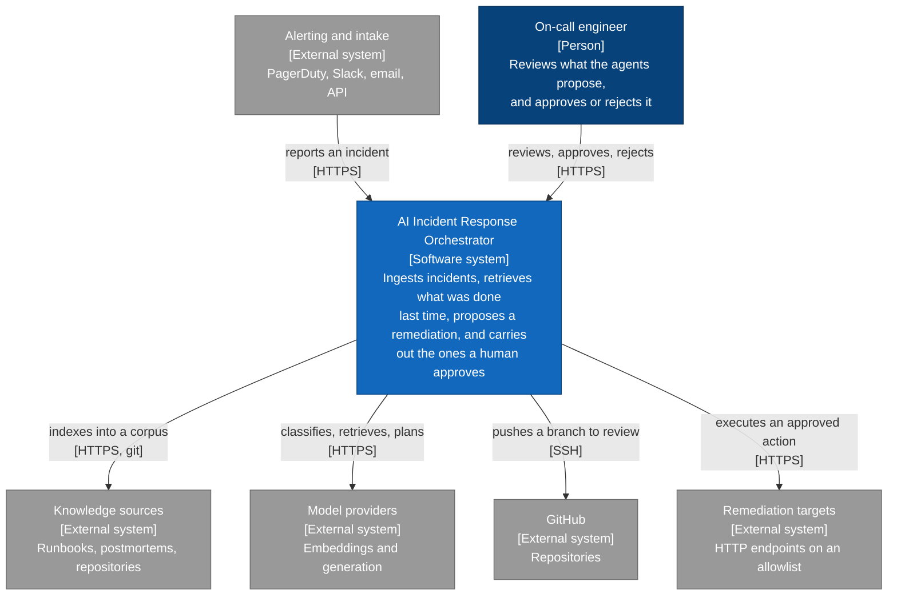
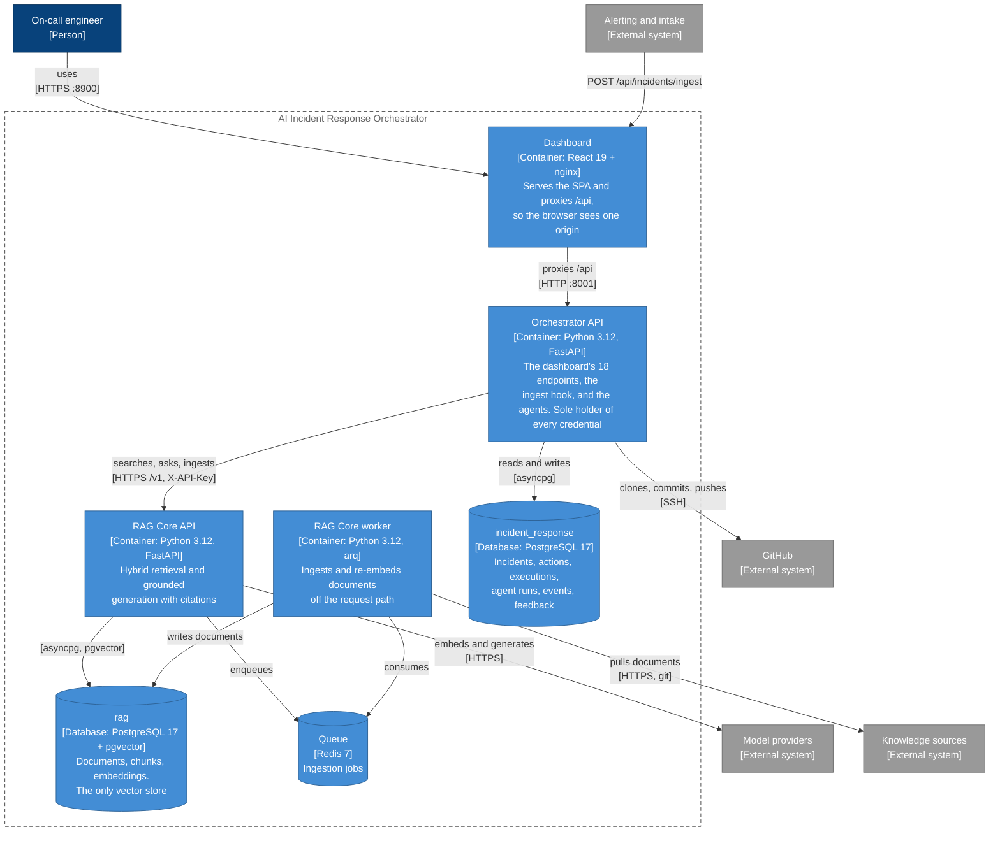
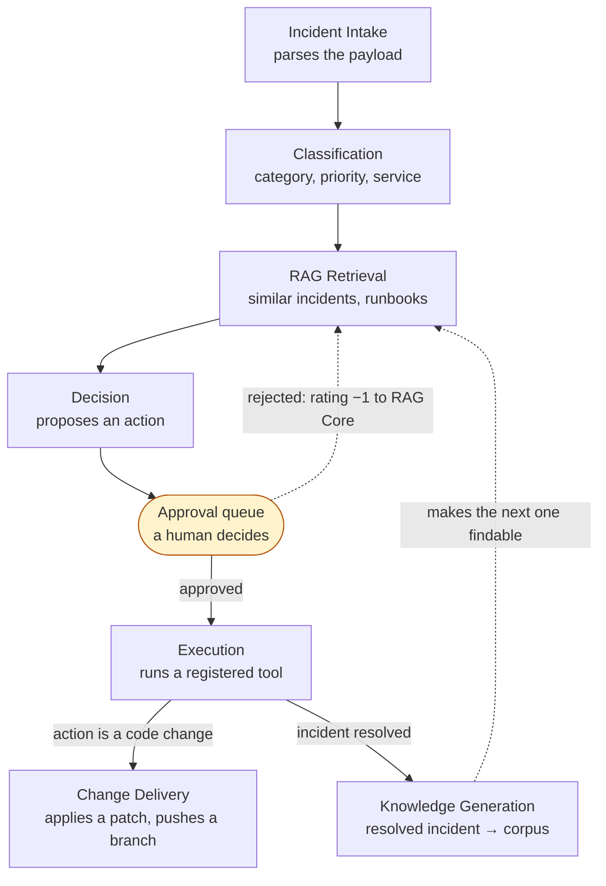
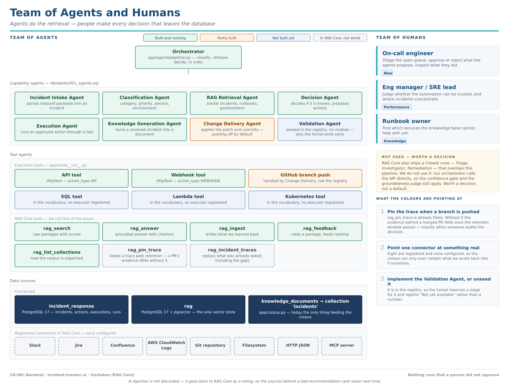

# Architecture

The whole system, across all three repositories — C4 levels 1 and 2, then an inventory
of what is actually built. The frontend's own internals are
documented in `Incident-tracker-ui/docs/architecture.md`; this is the view that spans them.

Two boundaries account for most of the design, and both are visible in the level 2 diagram:

- **The browser talks to one origin and holds no credentials.** nginx serves the SPA and
  proxies `/api`, so the dashboard never learns that RAG Core exists.
- **The orchestrator is the only thing that holds them.** RAG Core authenticates with a
  static key whose scope also covers `/v1/secrets`, and the deploy key can write to a
  repository. Neither may reach a client.

> The diagrams use C4 element notation — every box carries its name, its **[type and
> technology]**, and what it is for — drawn as Mermaid flowcharts rather than with Mermaid's
> `C4Context` renderer, which reserves an enormous mostly-empty canvas and is unreadable at
> this size. The model is C4; the drawing tool is the one that renders.

## Level 1 — System context

**What the operator is for.** The system proposes; it does not decide. Every action that
touches anything outside this database waits for an approval, and a rejection is recorded as
training signal rather than discarded — it is fed back to RAG Core so the sources behind a bad
recommendation rank lower next time.

## Level 2 — Containers

### What each container is, and where it lives

| Container | Repository | Port | Notes |
|---|---|---|---|
| Dashboard | `Incident-tracker-ui` | 8900 | nginx serves the bundle and proxies `/api`. Its own internals: `docs/architecture.md` there. |
| Orchestrator API | `CR-INC-Backend` | 8901 | This repository. Endpoints in `app/api/`, SQL in `app/queries/`, agents in `app/agents/`. |
| RAG Core API | `rag-core` | 8902 | Provider-agnostic. Hybrid retrieval, reranking, grounded answers. |
| RAG Core worker | `rag-core` | — | Ingestion, off the request path. |
| PostgreSQL | — | 8903 | **One instance, two databases.** They hold genuinely different data and neither should be able to migrate over the other's tables, but a stack meant to run on a laptop should not pay for two servers. |
| Redis | — | — | Not published to the host; only the worker and the RAG API reach it. |

Everything comes up from one file: `docker-compose.yml` in this repository, which builds all
three. A one-shot `migrate` service applies migrations and seeds and exits; the API waits for
it, so a first request cannot race an unmigrated schema.

### The agents inside the Orchestrator API

Not containers — they run in-process, and each records an `agent_runs` row that the dashboard
renders as the incident's trace.

`Validation Agent` is registered but not implemented — it is why the Performance tab's funnel
still ends at "Validated + resolved: Not yet available" rather than showing a fabricated zero.

### What exists, and where it lives

The diagram above is the *sequence*. This one is the *inventory* — the same agents plus the
tools and data behind them, coloured by whether they are actually built, and separating "we
would have to write it" from "it already exists in RAG Core and we simply do not call it".
That second distinction is the one that keeps getting lost.

Regenerate it with `python docs/agent_map.py` rather than editing the SVG. Every colour on it
is a claim about the code, and a claim that nobody can cheaply re-check is one that goes stale
silently — the generator keeps each status next to the file that proves it.

Three of those claims are worth stating in prose, because a legend can say *not wired* but not
*why you should care*:

- **`rag_pin_trace` and `rag_incident_traces` already exist and we never call them.**
  `app/rag_client.py` covers five of RAG Core's seven tool surfaces. RAG Core's own
  `agents/README.md` is blunt about the consequence: a merged PR whose trace was never pinned
  404s once `TRACE_RETENTION_DAYS` passes, "precisely when someone audits the decision". The
  Change Delivery Agent pushes branches for PRs today, so this is already happening.
- **Eight ingestion connectors are registered in RAG Core and none are configured.**
  `slack`, `jira`, `confluence`, `aws_logs`, `git_repo`, `filesystem`, `http_json`, `mcp` —
  see `app/ingestion/sources/`. Nothing seeds the `sources` table, so the corpus contains only
  what `app/corpus.py` wrote back into it. The system can currently only recognise incidents it
  has already seen resolved.
- **RAG Core ships a CrewAI crew that overlaps this pipeline** (`agents/incident_crew.py`:
  Triage → Investigator → Remediation). We do not use it — the orchestrator calls the API
  directly, which keeps the confidence gate and the groundedness judge in play. That is a
  defensible choice, but it should be a decision on the record rather than an accident.

### Two things the diagrams cannot show

**The corpus has to be seeded before any of this finds anything.** On a fresh stack the RAG
holds nothing, so classification abstains and retrieval links nothing — correct behaviour, and
completely useless. `python -m app.corpus` pushes the local knowledge documents in, keyed by
each row's own UUID, which is the link retrieval resolves every hit back through.

**Nothing is executed that a person did not approve**, and the two agents with side effects
outside this database refuse rather than improvise: the Execution Agent runs a registered tool
or fails saying there is none, and the Change Delivery Agent only pushes to a repository on an
explicit allowlist, with pushing disabled by default.

## Related documents

- `app/README.md` — the agents in detail, and the security notes for change delivery
- `db/README.md` — the schema
- `Incident-tracker-ui/docs/architecture.md` — the frontend's internals
- `ai_incident_response_database_schema.md` — the authoritative data model
