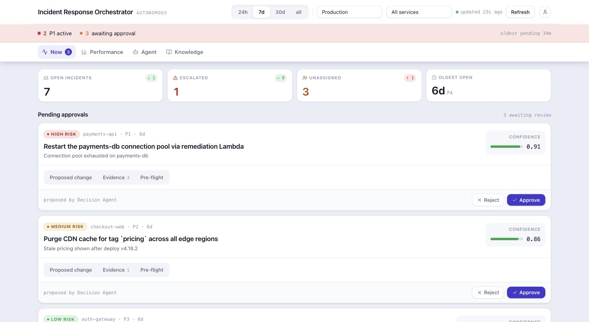
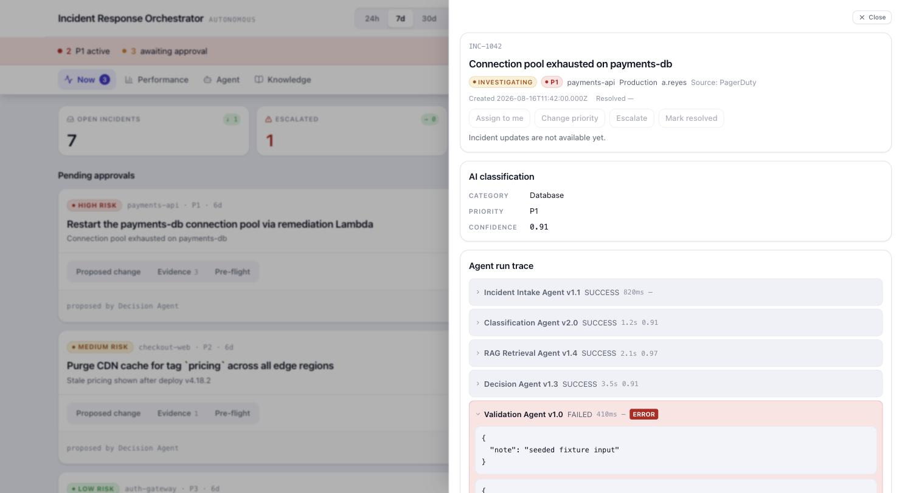
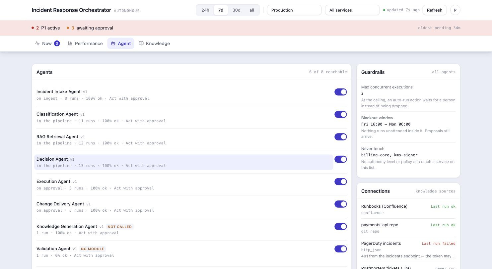
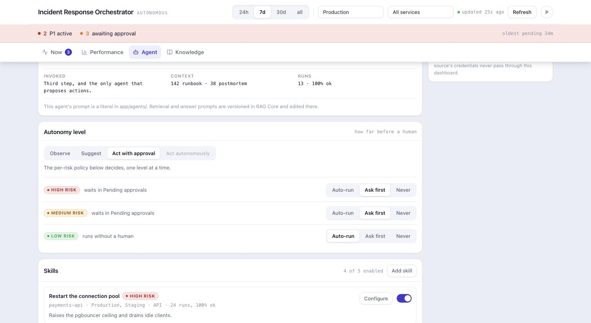
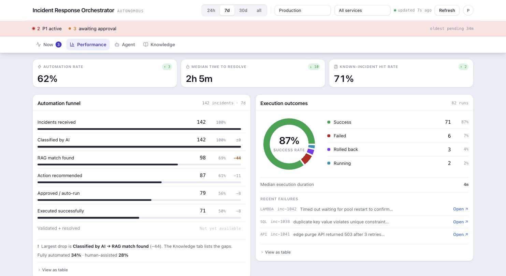
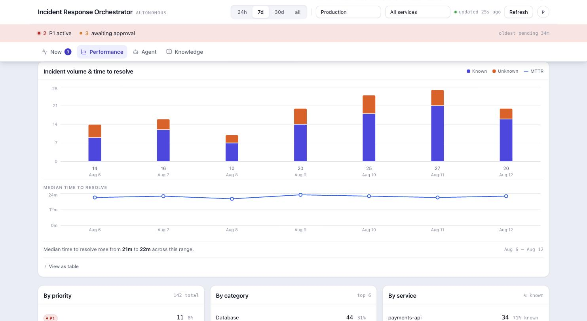
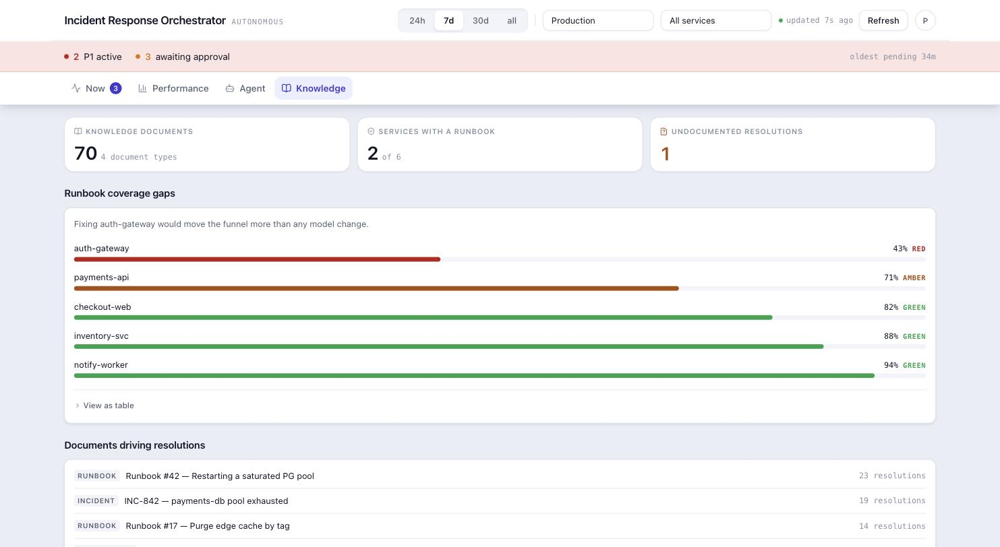

# Team 13 — AI Incident Response Orchestrator

Three services that together take an incident from an inbound alert to a reviewed remediation,
with the evidence attached at every step.

The idea the whole thing is built on, and the fair way to judge it: **agents propose, a person
decides, and everything is traceable.** Nothing is asserted that the system cannot show you the
basis for — where a number came from, which rule produced an outcome, and what would happen if you
pressed the button. Where something does not work yet, it says so on screen instead of looking like
it works.

## Try it

**<https://maistro.skynetupb.store/>** — the whole stack, running.

There is **no login**. The dashboard is open to anyone with the link, and its
Approve and Reject buttons are real: approving a proposal starts an execution.
That is deliberate for a hackathon demo and is the first thing that would have to
change for anything else — `/api/*` has no authentication in front of it.

What you should see on arrival: 3 P1 incidents active, 4 proposals awaiting
review, and 15 incidents in the table. Every agent in the roster has real run
counts. One action has already executed unattended, which is the per-risk policy
working rather than a seeded row.

A tour that takes about two minutes:

1. **Now** — open the first approval card and click through its three panels.
   **Pre-flight** is the one to read: it says what would happen if you approved,
   and for the highest-confidence proposal in the queue the answer is "nothing" —
   no executor is registered for its action type.
2. **Agent** — the roster. Two agents are labelled `NOT CALLED` and `NO MODULE`,
   which is true and is the point. Change the LOW-risk row from Auto-run to Ask
   first and the next incident's proposal will wait for a person.
3. **Performance** — the funnel, and the sentence under it naming the largest
   drop.
4. **Knowledge** — which services have no runbook, worst first.

`Act autonomously` is greyed out on purpose. It removes the human from the loop,
so it needs `AGENT_AUTONOMY_ENABLED` set on the server deliberately, and this
deployment does not set it.

### If you need the RAG's own admin UI

RAG Core has its own interface — connectors, prompt versions, secrets — and it is
**not reachable through the domain above.** nginx publishes only the dashboard and
`/api`, so that service's admin surface is not on the internet at all. Reaching it
takes a tunnel to the host:

```bash
ssh -L 8902:localhost:8902 <user>@<host>
open http://localhost:8902        # it will ask for an API key
```

The key on this deployment is the placeholder straight out of
`CR-INC-Backend/.env.example`:

```
rag_sk_change_me
```

One key serves the whole stack: RAG Core registers it with admin scope on first
boot and the orchestrator authenticates with the same value. **It is a demo
credential and nothing else.** That scope covers `/v1/secrets`, where connector
tokens live, which is exactly why the orchestrator holds it and the browser never
sees it — and why the first step of any real deployment is
`openssl rand -hex 24` and a restart.

## The three folders

| Folder | What it is | Stack |
|---|---|---|
| **[`Incident-tracker-ui`](Incident-tracker-ui/)** | The dashboard an on-call engineer uses. Four tabs, an approval queue, and the agent configuration. | React 19, TypeScript, Vite, TanStack Query, Recharts, Tailwind 4 |
| **[`CR-INC-Backend`](CR-INC-Backend/)** | The orchestrator. Runs the agents over an incident, owns the approval lifecycle, and enforces the policy that decides what may run unattended. | FastAPI, asyncpg, PostgreSQL |
| **[`rag-core`](rag-core/)** | Retrieval. Hybrid search over runbooks and postmortems, and the only service that talks to a language model. | FastAPI, pgvector, arq, Redis |

Each folder has its own README with the detail.
**[`Incident-tracker-ui/README.md`](Incident-tracker-ui/README.md)** walks through every screen and
explains why each one is drawn the way it is.

## What it looks like

All four tabs, captured from the running app.

### Now — the approval queue



Every card shows the diff the agent wrote, the runbooks retrieval actually matched, and what would
happen if you approved it. Clicking any incident opens the drawer:



The trace is real provenance — model, latency, confidence and the actual input and output per agent.
The `Validation Agent v1.0 FAILED` row is not a mock: that agent is registered with no module behind
it, and the UI says so instead of hiding it.

### Agent — the orchestrator, and what each agent may do





`Auto-run | Ask first | Never` is where `approval_required` is decided. It used to be a literal
`TRUE` in an INSERT — the model was asked for a risk level, the value was stored, and nothing read
it, so nothing could ever run unattended at any risk level.

### Performance — where the work is lost





### Knowledge — what the corpus is missing



## How they fit together

```
        browser
           │  one origin: nginx serves the SPA and proxies /api
           ▼
    Incident-tracker-ui  ──────►  CR-INC-Backend  ──────►  rag-core  ──────►  model provider
       (nginx + SPA)                (orchestrator)          (retrieval)
                                          │
                                          ▼
                                     PostgreSQL
```

Three properties of that shape are deliberate, and each one is a decision the code enforces rather
than a diagram's promise:

**The browser never sees the RAG's key.** Only the orchestrator holds it, because that key's scope
covers `/v1/secrets` — where connector credentials live. It is why the dashboard's Connections panel
is read-only: proxying a source's credentials through an endpoint the browser can reach would make
the orchestrator a confused deputy over a service it is supposed to protect.

**The orchestrator carries no LLM SDK at all.** Its agents generate through the RAG's `/v1/answer`,
so retrieval is not something an agent can skip. If the corpus has nothing to say, the pipeline
stops before proposing a remediation rather than inventing one.

**RAG Core abstains rather than guessing.** Below a measured confidence threshold it declines and
says why. The threshold is derived from an evaluation run, not chosen — see that folder's README.

## Running it yourself

Everything comes up from one compose file, in `CR-INC-Backend`, which builds all three. It expects
the other two as sibling directories, which is exactly this layout — verified against these folder
names, not assumed:

```bash
cd CR-INC-Backend
cp .env.example .env          # set ANTHROPIC_API_KEY or OPENAI_API_KEY, and VOYAGE_API_KEY
docker compose up -d --build  # first build takes a few minutes

# The RAG corpus starts EMPTY. Without this the agents correctly abstain from
# everything, and the dashboard has nothing to show.
docker compose run --rm orchestrator python -m app.corpus

open http://localhost:8900
```

To work on the dashboard alone, with no backend at all:

```bash
cd Incident-tracker-ui && npm install && npm run dev
```

Every request is intercepted in the browser by MSW against a seeded fixture dataset, so the whole
app is interactive with zero setup — including creating an agent skill and stepping through an
approval.

## Where the interesting decisions are

If you only read a few things:

- **[`DEMO-VIDEO.md`](DEMO-VIDEO.md)** — a three-minute walkthrough, verified by running the whole
  stack rather than written from the spec: every number in it came out of the app. It ends with a
  table of what was measured and then a list of what is **not** presentable and why, which is the
  most honest thing in this repository.

- **[`Incident-tracker-ui/README.md`](Incident-tracker-ui/README.md)** — the screens, and for each
  one why it is drawn the way it is. The parts worth reading explain a defect that was fixed rather
  than a feature that was added: why the funnel's bars encode share of received rather than
  conversion rate, and why two colours in the outcome donut had to be replaced after being measured
  at ΔE 0.4 under deuteranopia — the same colour, for a colourblind reader.
- **`CR-INC-Backend/app/agents/policy.py`** — the single point that decides whether a human sees an
  agent's proposal. Every guard it applies is reported to the operator with the sentence that
  justifies it.
- **`CR-INC-Backend/app/agents/preflight.py`** — what would happen if you approved this, answered
  *before* the approval by calling the same guards the executor calls. On the seeded data it
  immediately reveals that the highest-confidence proposal in the queue has no executor registered
  and would do nothing at all.
- **`CR-INC-Backend/db/seeds/004_code_change_runbooks.sql`** — three runbooks written so the
  planner returns a *grounded* diff instead of an invented one: they carry the repository as
  `org/repo`, the file with real line numbers, and the old and new values side by side. Without
  that shape the agent has to guess a filename, and the patch comes out add-only.

## Repository history

These three were separate repositories, referenced here as git submodules. Submodules make a
submission hard to read — a clone needs `--recursive` plus access to each private repo — so they are
now plain folders, exported from each project's tracked files. The upstream repositories keep their
own commit history; this repo holds the code as it stood at submission.
