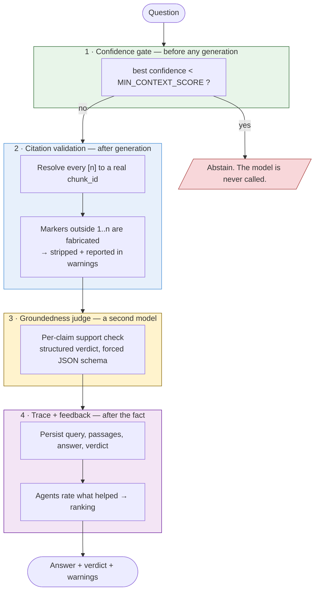

# Anti-hallucination

Four independent layers. They are listed in order of how much they actually buy you, which is not the order people usually build them in.



## 1 · Confidence gate

**Catches:** questions the corpus simply cannot answer — the single largest source of hallucination in any RAG system. A model handed five irrelevant passages and a question will usually still produce a confident answer.

If the best retrieved passage scores below `MIN_CONTEXT_SCORE`, the service returns an abstention and **never calls the generator**. That makes it the cheapest layer as well as the most effective: no LLM round trip, no tokens.

The subtlety that makes or breaks it is *which score* is compared:

```python
def confidence_of(candidate):
    if candidate.rerank_score is not None:   return candidate.rerank_score
    if candidate.vector_score is not None:   return candidate.vector_score
    if candidate.lexical_score is not None:  return candidate.lexical_score
    return 0.0
```

Never the RRF score. RRF is rank-based, so the top hit of *any* search scores near maximum — including a search over a corpus with nothing relevant in it. A threshold on RRF can never fire, and the gate becomes decorative while looking implemented. This was a real bug here, caught only when an out-of-corpus question sailed through to the generator.

The gate reads the **best** candidate, not the first: results are ordered by fusion score, which is not the same ordering as absolute confidence.

## 2 · Citation validation

**Catches:** fabricated sources — a model citing `[7]` when it was given four passages.

Every `[n]` in the answer is resolved back to a real `chunk_id`. Markers outside the supplied range are stripped from the text and reported in `warnings`. A caller can never resolve a citation to a source that does not exist, because the invalid ones never leave the service.

This is mechanical, not probabilistic. It cannot be prompted away and does not depend on the model cooperating.

`REQUIRE_CITATIONS=true` additionally warns when an answer contains no citations at all.

## 3 · Groundedness judge

**Catches:** claims that go beyond the passages while citing them — the failure mode the first two layers cannot see, because the citation is real and the confidence was fine.

A second model call classifies each claim as `supported` / `partially_supported` / `unsupported` and returns a structured verdict:

```json
{
  "score": 0.92,
  "verdict": "grounded",
  "unsupported_claims": [],
  "reasoning": "..."
}
```

Three deliberate choices:

- **Structured output, not free text.** `output_config.format` with a JSON schema, so the verdict needs no parsing and the parse cannot itself fail.
- **A warning, not a veto.** Below `MIN_GROUNDEDNESS_SCORE` the answer is returned *with* the warning. Silently withholding an answer the model did produce hides information from an operator mid-incident.
- **A judge failure never fails the answer.** It degrades to `verdict: "unknown"` and is reported.

Cost: one extra call per answer, run at `JUDGE_EFFORT=low`. Disable with `GROUNDEDNESS_CHECK=false` if latency matters more.

## 4 · Trace and feedback

**Catches:** nothing directly — it is what makes the other three improvable.

Every query persists the candidates with their full score breakdown, the answer, the citations, the verdict and the latency. When an answer is wrong you can see exactly which passages were retrieved and how they ranked, instead of guessing.

Agents post `/feedback`; ratings aggregate into `chunk_feedback_scores` and multiply the fusion score by `1 ± FEEDBACK_WEIGHT`, so passages that repeatedly help rank higher.

## What each layer cannot do

| Layer | Blind to |
|---|---|
| Confidence gate | A highly-similar passage that is wrong or outdated |
| Citation validation | A real citation attached to a claim the passage does not make |
| Groundedness judge | Passages that are themselves wrong — it checks support, not truth |
| Trace + feedback | Anything, until a human or agent actually rates something |

None of them verify that the **corpus** is correct. An outdated runbook produces a well-cited, high-confidence, grounded, wrong answer. That is a content-freshness problem, which is what the incremental connectors and `source_updated_at` are for — not something a guardrail can fix.

## Reading a response

```json
{
  "answer": "Scale pgbouncer before scaling the API [1]...",
  "abstained": false,
  "confidence": 0.71,
  "citations": [{"marker": 1, "chunk_id": "...", "external_id": "runbook/payments-timeout"}],
  "groundedness": {"score": 0.92, "verdict": "grounded", "unsupported_claims": []},
  "warnings": []
}
```

| Field | Meaning |
|---|---|
| `abstained` | **Not an error.** The corpus cannot support an answer; `abstain_reason` says which gate fired |
| `confidence` | Absolute relevance of the best passage, `[0, 1]` |
| `citations` | Only markers that resolved to real chunks |
| `groundedness.verdict` | `grounded` / `partially_grounded` / `ungrounded` / `unknown` |
| `warnings` | Stripped citations, missing citations, low groundedness |

An abstention returns `sources` too, so a caller can see what *was* found and decide for itself.

## Tuning the trade-off

Both thresholds trade false answers against false refusals:

- Raise `MIN_CONTEXT_SCORE` → fewer weak answers, more refusals on answerable questions.
- Lower it → fewer refusals, more answers built on thin evidence.

**The value is measured, not chosen.** `make eval` reports the confidence of questions the corpus can answer against those it cannot, and the threshold belongs in the gap between them — see [evaluation.md](evaluation.md).

That measurement changed the number. It had been `0.35`, picked by reading a handful of scores by hand; the measured ceiling for out-of-corpus questions is `0.427`. Three of four such questions — including one phrased as an invented incident id, `INC-9999` — therefore cleared the gate and reached the model.

They were answered correctly anyway ("The passages do not contain information about…"), because layer 2 held. That is the point of having four layers, and also the reason the failure went unnoticed: a guardrail propped up by the next one down looks like a working guardrail. At `0.48` the gate fires and the model is never called.

Re-derive it whenever the embedding model or the corpus changes. Both move the distributions, and a stale threshold fails silently in the expensive direction.

## Prompt design

The generator prompt is deliberately short. Long "NEVER hallucinate / YOU MUST ALWAYS" prompts read as noise to current models and make them hedge; the real guarantees here are mechanical — a score threshold, a regex resolving markers against a list, a schema-forced verdict — not textual. The prompt states the rules once, plainly, and the machinery enforces them.
