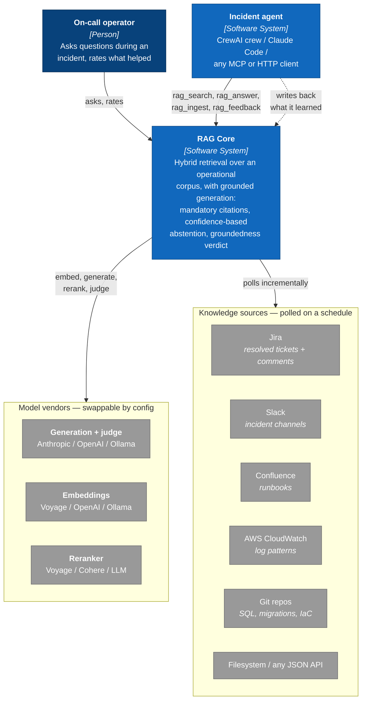

# C4 Level 1 — System Context

Who uses the service, and what it depends on.

## What the system is responsible for

| Responsibility | Why it lives here and not in the agent |
|---|---|
| Retrieval quality | Hybrid search, fusion and reranking are stateful and tunable; every consumer benefits from one tuned implementation. |
| Refusing to answer | The abstention gate must be enforced centrally. An agent that decides for itself whether the evidence is sufficient will eventually decide wrong. |
| Citation integrity | Fabricated citations are stripped server-side, so no consumer can surface a source that does not exist. |
| Audit trail | Every query, passage, answer and verdict is persisted in one place, independent of which agent asked. |

## Two consumer shapes

**Retrieval-only** (`/search`, `rag_search`) — the caller gets passages with scores and reasons over them itself. No LLM tokens are spent by the service. This is the right call when the agent is already holding context the service does not have.

**Grounded answer** (`/answer`, `rag_answer`) — the service retrieves, gates on confidence, generates, validates the citations, and judges the result. The caller gets prose plus a verdict it can act on.

The distinction matters because `abstained: true` is a *result*, not a failure: it means the corpus cannot support an answer. A consumer that treats it as an error and falls back to its own knowledge silently defeats the whole design.

## Trust boundaries

- Consumers authenticate with an API key carrying `read` / `write` / `admin` scopes and a per-key rate limit.
- Connector credentials are referenced as `${NAME}` and resolved at poll time from the encrypted vault first, then the **worker's** environment. Vault rows are AES-256-GCM ciphertext under `SECRETS_KEY`, which lives in the server environment; no endpoint returns a plaintext secret, and `GET /v1/sources` redacts any literal credential a caller managed to POST.
- Model vendors receive query text and retrieved passages. Anything indexed is anything sent — the corpus boundary is the privacy boundary.

---

Next: [C4 Level 2 — Containers](02-containers.md)
