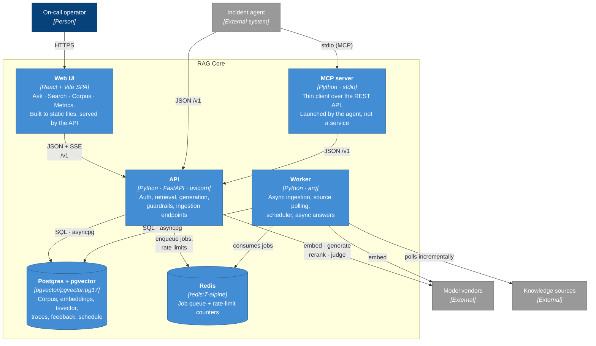

# C4 Level 2 — Containers

The deployable units and how they talk. Names match `docker-compose.yml` services.

## Why these boundaries

**API and worker are separate processes.** Embedding a 500-document batch takes minutes and is IO-bound on a vendor API. Doing it in the request path would hold a connection, block a uvicorn worker, and give the caller a timeout instead of an answer. The split also means a wedged connector cannot take the query path down.

**Both run the same image.** They differ only by command (`uvicorn` vs `arq`). One build, one dependency set, no drift between what the API can parse and what the worker can ingest.

**The MCP server is not a service.** It speaks stdio and is spawned by the agent's client (Claude Code, Claude Desktop). It holds no state and implements no logic — it maps tool calls onto the same REST endpoints a curl user would hit, so guardrails cannot be bypassed by choosing a different door.

**Postgres holds everything, including the schedule.** Source intervals live in the `sources` table rather than in cron entries, so a poll interval can be changed through the API at runtime without redeploying the worker.

## Degraded modes

The system is deliberately not all-or-nothing:

| Dependency lost | What still works | What stops |
|---|---|---|
| **Redis** | Search, answers, and ingestion (the API falls back to ingesting synchronously) | Background jobs, source polling, rate limiting |
| **Worker** | Everything the API serves; `/documents` degrades to synchronous | Scheduled polling, async answers, re-embedding |
| **Reranker vendor** | Retrieval, ranked by fusion order instead | Cross-encoder precision — logged, not fatal |
| **Groundedness judge** | The answer, with `groundedness.verdict = "unknown"` | The verdict only |
| **Generation vendor** | `/search` unaffected | `/answer` returns an abstention naming the provider error |
| **Postgres** | Nothing | Everything — this is the single hard dependency |

## Ports and images

| Service | Image | Host port (override) | Health check |
|---|---|---|---|
| `postgres` | `pgvector/pgvector:pg17` | `55432` (`POSTGRES_PORT`) | `pg_isready` |
| `redis` | `redis:7-alpine` | `56379` (`REDIS_PORT`) | `redis-cli ping` |
| `api` | built from `Dockerfile` | `8000` (`API_PORT`) | `GET /v1/health` |
| `worker` | built from `Dockerfile` | — | — |
| `frontend` (dev only) | `node:22-alpine` | `5173` | — |

Host ports default off the standard 5432/6379 so the stack coexists with other local Postgres and Redis instances. Containers reach each other by service name, so the mappings only matter for tools on the host.

---

Next: [C4 Level 3 — Components](03-components.md)
