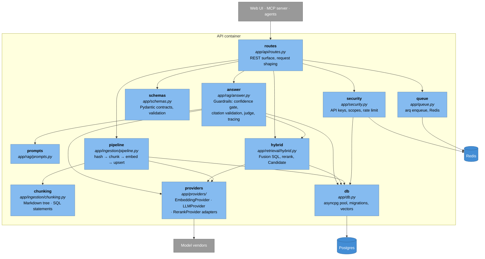
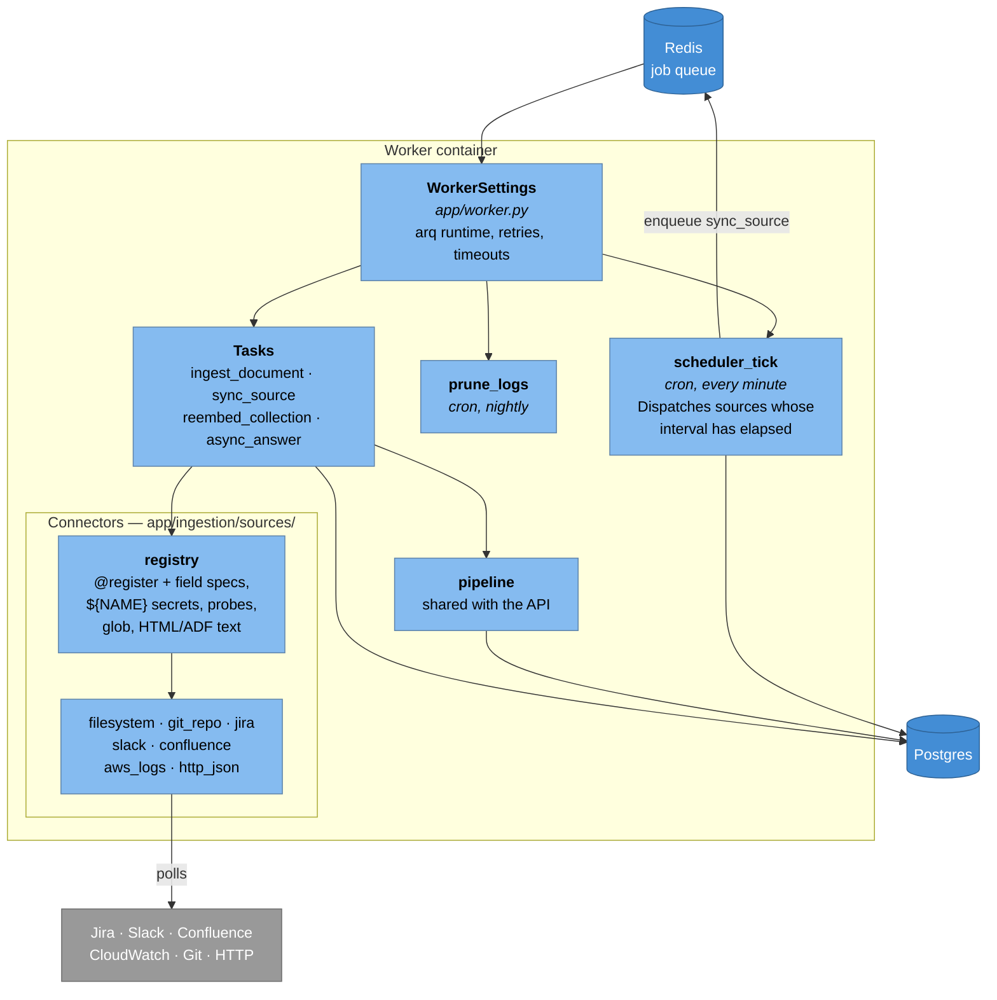

# C4 Level 3 — Components

Inside the two Python containers. Every box is a real module.

## Inside the API



### The dependency rule that matters

`retrieval`, `rag` and `ingestion` depend on `providers` only through the abstract interfaces in `app/providers/base.py`. No module outside `app/providers/` imports a vendor SDK or knows a vendor name. That is what makes swapping Voyage for OpenAI a `.env` change rather than a refactor — and it is the invariant to protect when adding a provider.

`answer` depends on `hybrid`, never the reverse. Retrieval knows nothing about generation, so `/search` costs no LLM tokens.

## Inside the worker



### Connector contract

Every connector is one function with the same signature, registered by decorator:

```python
@register("jira")
async def run_jira_source(collection: str, config: dict, cursor: dict) -> SourceRun:
    ...
    return SourceRun(documents=[...], cursor={"updated_since": watermark})
```

The connector owns its cursor and decides what "changed since last time" means for its system — a watermark, a commit SHA, an mtime, a timestamp window. Everything downstream (hashing, chunking, embedding, upserting, job accounting) is shared, so a new vendor is one file plus one decorator.

`SOURCE_TYPES` is derived from the registry at import time, and `SourceIn` in `app/schemas.py` validates against it — registering a connector makes it accepted by the API with no schema edit.

## Component responsibilities

| Component | Owns | Explicitly does not |
|---|---|---|
| `routes` | HTTP shape, status codes, scope checks | Retrieval or generation logic |
| `security` | Key hashing, scopes, per-key rate limit | Vendor credentials |
| `hybrid` | The fusion SQL, reranking, `Candidate` | Deciding whether evidence is sufficient |
| `answer` | All four guardrails, tracing | Talking to Postgres for retrieval |
| `pipeline` | Idempotency, chunk replacement, status | Knowing where documents came from |
| `chunking` | Markdown tree, SQL statements, overlap | Embeddings |
| `providers` | Every vendor SDK and HTTP call | Business rules |
| connectors | Fetching and cursors | Chunking, embedding, storage |

---

Next: [C4 Level 4 — Code](04-code.md)
