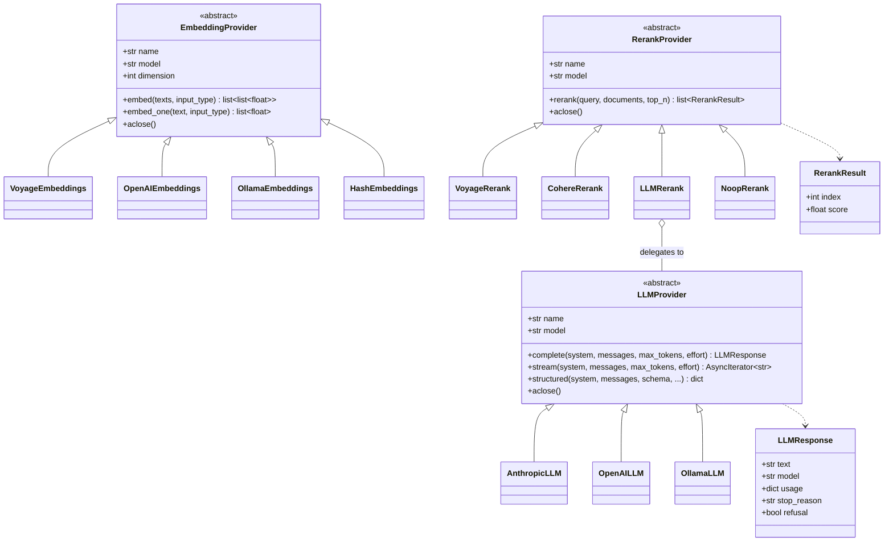
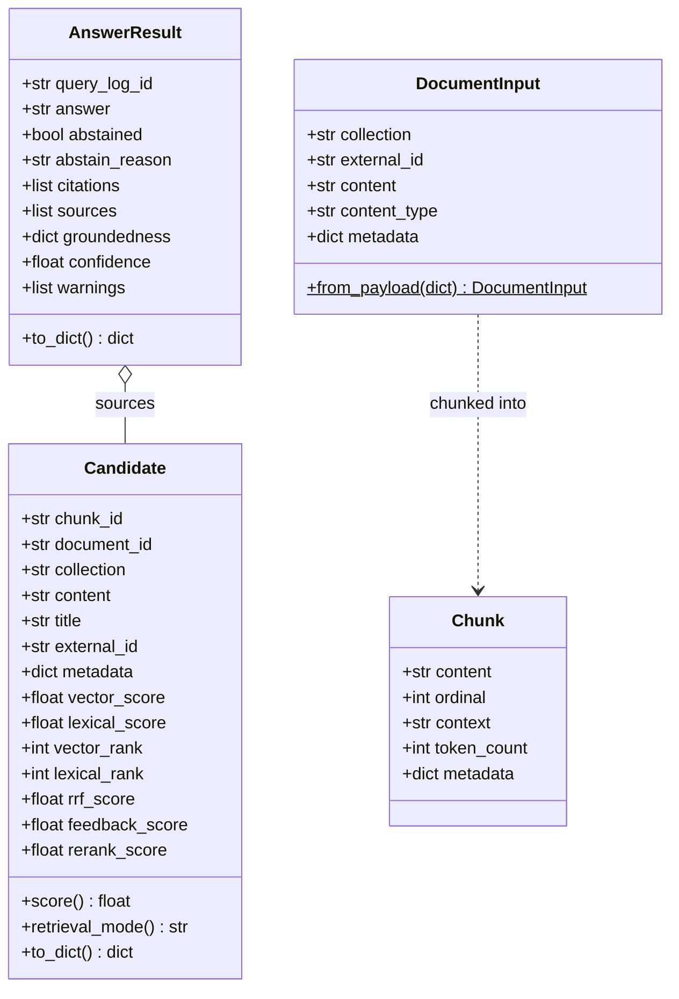

# C4 Level 4 — Code

Level 4 is only worth drawing where the shape of the code carries a decision. Two places qualify: the provider adapter layer (what makes the system vendor-agnostic) and the retrieval types (what flows through the guardrails).

## Provider adapters

### Details the diagram cannot show

**`input_type` is not decoration.** Voyage and Cohere are asymmetric models: the same text embeds differently as a stored document than as a search query. Passing the wrong one measurably degrades recall, so it is part of the interface rather than a provider-internal default.

**`structured()` exists because the judge cannot be trusted to format itself.** A free-text verdict would need parsing, and the parse itself becomes a failure mode. Anthropic gets `output_config.format` with a JSON schema, OpenAI gets `response_format`, Ollama gets `format` — one method, three vendor mechanisms.

**`refusal` on `LLMResponse` is a first-class outcome.** Anthropic returns HTTP 200 with `stop_reason: "refusal"` and an empty or partial `content`; code that indexes `content[0]` crashes. Incident data — exploit traces, log dumps, security tooling — sits close enough to policy categories to trip false positives, so the adapter checks `stop_reason` before touching content and the service degrades to an abstention instead of a 500.

**`HashEmbeddings` is a plumbing stub, not a model.** It makes the whole pipeline runnable offline with no vendor key. It has no semantics; never enable it where answers matter.

**`LLMRerank` composes rather than inherits.** It holds an `LLMProvider` and turns ranking into a structured call, so a deployment with no dedicated rerank endpoint still gets cross-encoder-ish behaviour from the model it already pays for.

The registry in `app/providers/__init__.py` builds one lazy singleton per kind, shared by the API and the worker. `judge()` aliases `llm()` when the models match, so `close_providers()` deduplicates by object identity before closing.

## Retrieval types

`Candidate` deliberately keeps **every** score component rather than collapsing to one number. `retrieval_mode` is derived from which ranks are present (`hybrid` when both branches found it), and the Search screen renders the breakdown — that is how you can tell at a glance whether the lexical branch is actually contributing or has silently stopped matching.

The two score accessors are not interchangeable, and confusing them was a real bug:

- `Candidate.score` — what results are **ranked** by (reranker if present, else RRF).
- `confidence_of(candidate)` in `app/rag/answer.py` — what the abstention gate **reads**: reranker score, else cosine similarity, else lexical rank. Never RRF, because RRF is rank-based and the top hit of any search scores near maximum no matter how irrelevant the corpus is. See [decisions.md](../decisions.md#confidence-is-not-the-rrf-score).

`DocumentInput.from_payload()` is the single entry point for JSON-decoded documents. Payloads reach the worker through Redis and `ingestion_jobs`, so timestamps arrive as ISO strings; asyncpg rejects a `str` for a `timestamptz` parameter, and parsing in one place keeps every async path correct.

---

Next: [Deployment](deployment.md)
