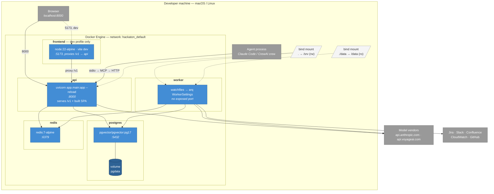
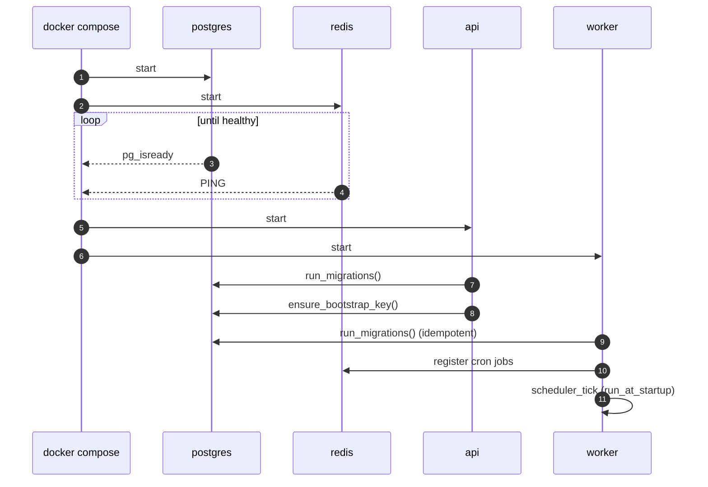

# Deployment — local (docker compose)

The topology that runs today and that a reviewer can reproduce with `make up`.



## Startup order and health gating

`api` and `worker` both declare `depends_on: { postgres: service_healthy, redis: service_healthy }`, so neither starts until Postgres answers `pg_isready` and Redis answers `PING`. Without that gate the first migration races the database's own initialization.



Migrations run from **both** containers. `schema_migrations` makes that safe: each file is applied once, inside a transaction, whichever process gets there first.

## Volumes and mounts

| Mount | Purpose | Note |
|---|---|---|
| `pgdata` volume | Database durability | `make reset` drops this — it is the only destructive target |
| `.` → `/srv` (rw) | Hot reload for API and worker | Development convenience; a production image copies the code instead |
| `./data` → `/data` (ro) | Corpus for `filesystem` sources | Read-only on purpose: ingestion must never mutate its input |
| `/tmp/rag-repos` (in-container) | `git_repo` clone cache | Ephemeral; a cold start just re-clones shallow |

## Configuration

`.env` is loaded by compose via `env_file` and by the app via pydantic-settings. Compose overrides `DATABASE_URL` and `REDIS_URL` to service names, so the same `.env` works on the host (`localhost:55432`) and inside containers (`postgres:5432`).

Connector secrets are referenced from source configs as `${VAR}` and resolved from the **worker's** environment, which is why they belong in `.env` rather than in the JSON config body.

## What this topology is not

This is a development and demo topology. Before it faces real traffic:

- **`--reload` and `watchfiles` must go.** Both watch the filesystem and reload on change; in production the code is baked into the image.
- **CORS is `allow_origins=["*"]`.** Fine when the SPA is same-origin behind the API; restrict it the moment anything else calls the API from a browser.
- **The API key lives in the browser's `localStorage`.** Acceptable for a demo or an internal tool; a public deployment needs a session-cookie BFF so the key never reaches the client.
- **No TLS, no replicas, no backups.** Postgres is a single container with one volume.
- **Bind-mounting the source into containers** means the running code is whatever is on disk, not what was built.

A production topology (managed Postgres with pgvector, a Redis service, separate API and worker scaling, secrets in a vault, IAM role for the CloudWatch connector) is deliberately not drawn here — the target platform has not been chosen, and a diagram of infrastructure nobody has agreed to is documentation that ages badly.

## Operating

```bash
make up       # build and start everything; creates .env from .env.example if missing
make seed     # load the demo runbooks and incidents
make logs     # tail api + worker
make health   # GET /v1/health — reports postgres, redis and resolved providers
make psql     # database shell
make reset    # stop and DROP the data volume
```

`GET /v1/health` returns `status: "degraded"` rather than failing when Redis is unreachable, because the API still serves queries without it — see the degraded-mode table in [containers](02-containers.md#degraded-modes).
