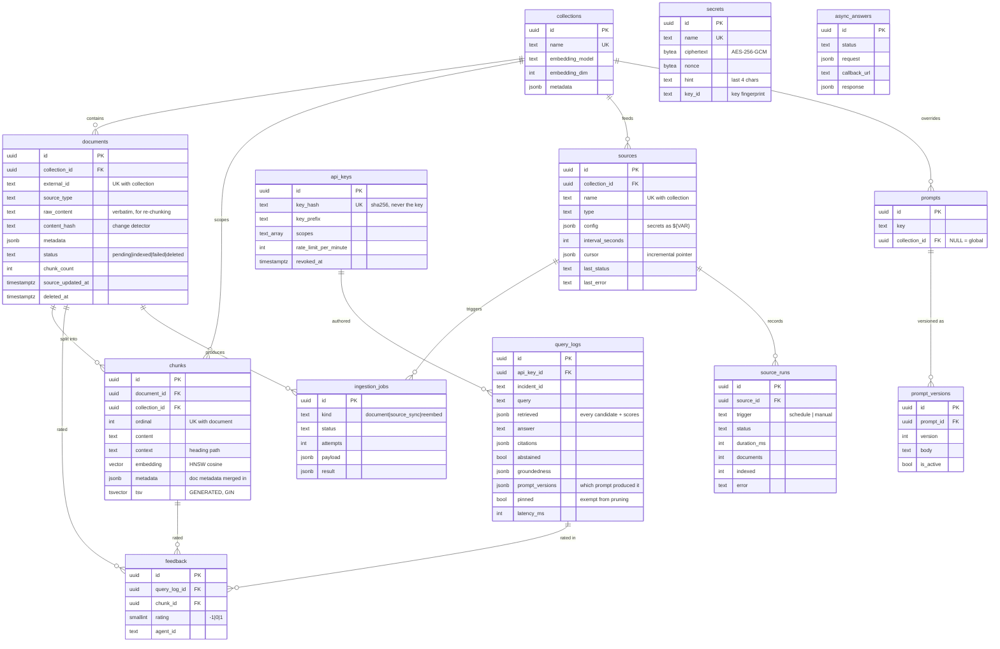

# Data model

One Postgres database holds the corpus, the vectors, the schedule, and the audit trail. Schema: `db/migrations/001_init.sql`.



## Tables

**`collections`** — the isolation unit. Each carries its own `embedding_model` and `embedding_dim`, because vectors from two different models are not comparable; mixing them silently destroys recall. A model change requires `POST /v1/collections/{name}/reembed`.

**`documents`** — one row per source object, keyed `(collection_id, external_id)`. `content_hash` covers body plus metadata and is the entire change-detection mechanism. `raw_content` keeps the original verbatim so re-embedding re-chunks from the source rather than from lossy chunk text. `deleted_at` soft-deletes while chunks are hard-deleted, so the index reclaims space but the audit trail survives.

**`chunks`** — the retrieval unit. Three indexed representations of the same text:

| Column | Index | Serves |
|---|---|---|
| `embedding` | HNSW, `vector_cosine_ops` | Semantic branch |
| `tsv` | GIN, generated column | Lexical branch |
| `metadata` | GIN, `jsonb_path_ops` | Filtering |
| `content` | GIN, `gin_trgm_ops` | Fuzzy fallback / ILIKE |

`metadata` carries the document's metadata merged in, so one containment filter (`@>`) covers both levels with no join.

**`sources`** — the schedule lives here, not in cron. `cursor` is opaque to the framework: each connector defines its own shape.

**`query_logs`** — the full trace of every query: the candidates with all their scores, the answer, the citations, the verdict, the latency. This is simultaneously the audit trail, the debugging surface, and the training signal. Pruned after `TRACE_RETENTION_DAYS` by a nightly job — **unless `pinned`**, because a PR that links to its justification outlives any retention window.

`prompt_versions` records which prompt produced the answer. Without it, editing a prompt silently makes every past trace unexplainable: the answer no longer matches what the current prompt would produce, and nothing records why.

**`source_runs`** — one row per poll attempt. `sources.last_status` is overwritten every time, so a connector failing one poll in ten looks healthy nine times out of ten; this is the table to read when diagnosing.

**`secrets`** — connector credentials, AES-256-GCM. The name is the AES-GCM associated data, so a ciphertext moved between rows fails to decrypt rather than becoming a different token. `key_id` is a fingerprint of the key, which turns a rotated `SECRETS_KEY` into a clear error instead of a corrupt value surfacing as a vendor 401 days later. `hint` is the last four characters and the only part any endpoint returns.

**`prompts` / `prompt_versions`** — `prompts` is addressed by `(key, collection_id)` with `NULLS NOT DISTINCT`, so the global row is unique on its own; without it two global rows for the same key would both be allowed and the winner would depend on row order. Versions are immutable, and a partial unique index on `is_active` enforces exactly one active version per prompt in the database rather than in application code that has to remember to deactivate the previous one.

**`feedback`** + the `chunk_feedback_scores` view — aggregated per chunk and folded into ranking as a multiplicative nudge.

## Index rationale

**HNSW over IVFFlat.** IVFFlat needs a training step sized to an existing corpus, and its recall degrades as the corpus grows past what it was trained on. HNSW has no training step and stays accurate while documents are being added live — which is the normal state here.

**Generated `tsvector` over a trigger.** The column is always consistent with `content` by construction. The trade-off is that the text-search configuration is baked into the schema: changing `FTS_CONFIG` means a migration and a reindex.

**`jsonb_path_ops` over the default `jsonb_ops`.** Smaller and faster for the containment queries this system actually issues; it gives up the operators nobody here uses.

## Why the feedback nudge is multiplicative

```sql
f.rrf_score * (1.0 + $10::float * COALESCE(fb.avg_rating, 0.0))
```

RRF scores live around 0.03. An additive bonus of any useful magnitude would swamp the ranking; a multiplicative factor is scale-free and bounded by `FEEDBACK_WEIGHT` (default 0.15, so ±15%). Feedback nudges the ordering — it never overrides relevance.

## Migrations

Plain `.sql` files applied in filename order, tracked in `schema_migrations`, each inside a transaction. Two placeholders are substituted at apply time from settings:

| Placeholder | From | Effect |
|---|---|---|
| `__EMBEDDING_DIM__` | `EMBEDDING_DIM` | `vector(N)` column width |
| `__FTS_CONFIG__` | `FTS_CONFIG` | `to_tsvector('...', content)` |

Both the API and the worker run migrations on startup; `schema_migrations` makes whichever wins harmless.

Substitution uses explicit tokens rather than `str.format()` on purpose — the schema is full of `'{}'::jsonb` defaults that `format()` would try to interpret as placeholders.
