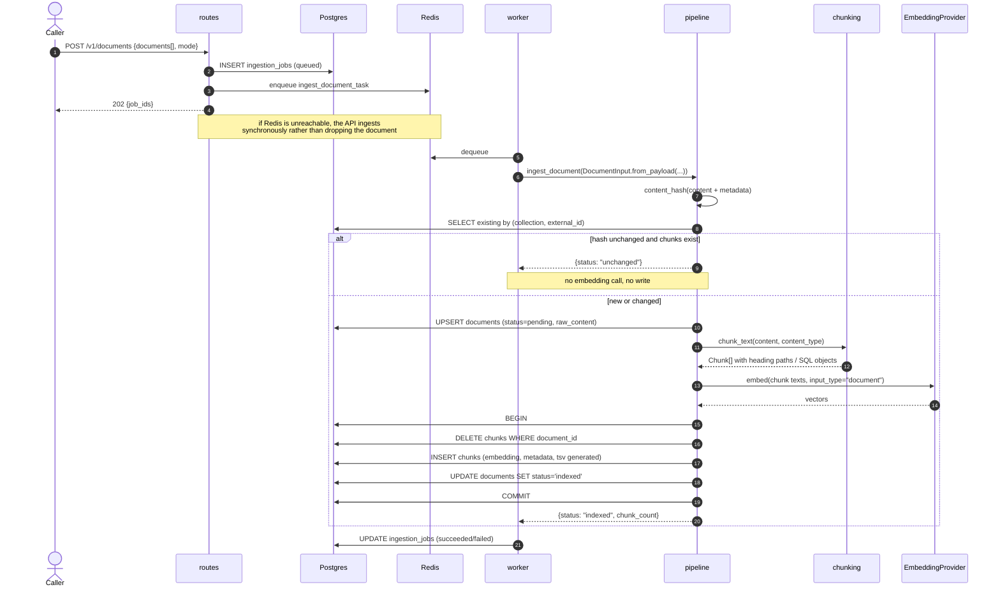
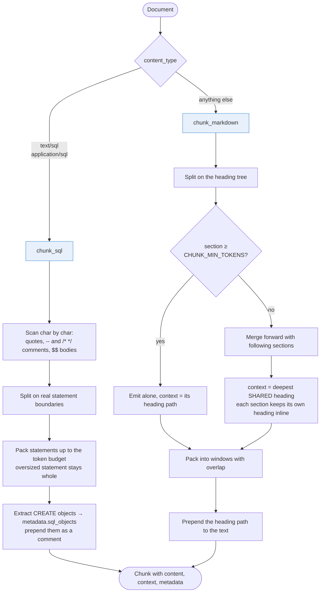

# Flow — ingesting a document

Everything that enters the index goes through one pipeline, whether it was pushed by an agent or pulled by a connector.

## Push path



## Idempotency

The key is `(collection, external_id)`; the change detector is `content_hash` over the body **and** the metadata. Re-ingesting unchanged content is a no-op with no embedding call, which is what makes a five-minute poll interval free when nothing changed.

Two consequences worth knowing:

- Chunks are **replaced wholesale**, not diffed. Re-embedding a document is one batched vendor call; a partial-diff chunker would be more code and more ways to leave the index inconsistent.
- Because the hash covers content only, a change to the *chunker itself* does not invalidate anything. After changing chunking logic, re-index deliberately with `POST /v1/collections/{name}/reembed`.

`raw_content` is stored verbatim precisely so re-embedding can re-chunk from the original. Chunk text is lossy — heading paths are prepended and windows overlap — so reconstructing a document by concatenating its chunks would compound that noise on every pass.

## Choosing a chunker



Both branches encode a failure they exist to prevent:

**SQL** — a naive `split(';')` breaks on semicolons inside string literals and inside `$$…$$` function bodies, which is most of a Postgres migration. A half `CREATE FUNCTION` retrieves as plausible SQL and is not runnable — worse during an incident than retrieving nothing.

**Markdown** — merged sections are labelled with the deepest heading they *share*, never the first one's. Labelling "never restart the primary database" as `Symptom` is how a runbook tells an operator the wrong thing about the wrong procedure.

The heading path is prepended to the embedded text because a chunk reading "restart the pods" is meaningless without knowing which service section it came from, and the embedding has no other way to learn that.

## Metadata inheritance

Document metadata is merged into every chunk's metadata at ingest time, plus `collection`, `external_id`, `source_type` and `title`. That is why one containment filter covers both levels:

```sql
WHERE c.metadata @> '{"service": "payments-api", "severity": "P1"}'::jsonb
```

with a single GIN index on `chunks.metadata`, and no join to `documents` for filtering.

## Failure handling

| Failure | Recorded where | Result |
|---|---|---|
| Document produces no chunks | `documents.status='failed'`, `error` | Job marked failed |
| Embedding call fails | `documents.status='failed'`, `error` | Job failed; arq retries up to `JOB_MAX_ATTEMPTS` |
| Queue unreachable | Response field `degraded` | Ingested synchronously instead |
| Collection missing | HTTP 404 | Nothing written |

A failed document keeps its previous chunks: the `DELETE`/`INSERT` pair is inside one transaction, so the index never has a half-rewritten document.

---

Next: [source polling](source-polling.md)
