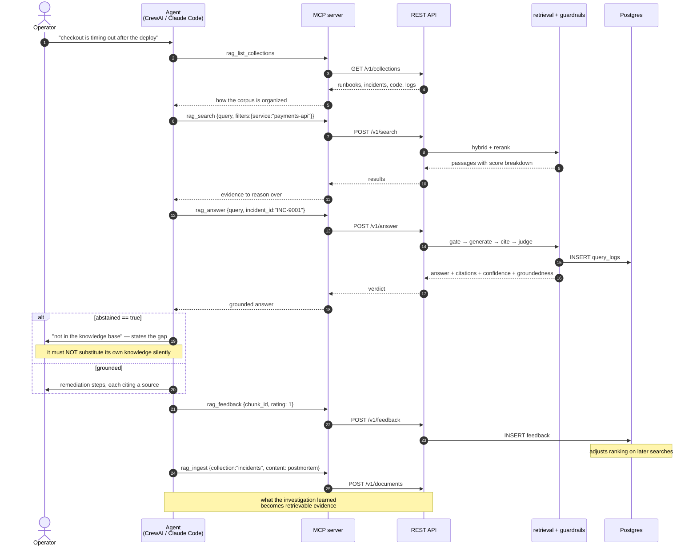
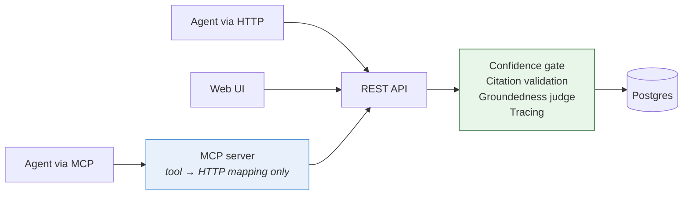
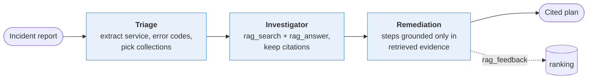

# Flow — an agent using the service

How an autonomous agent resolves an incident against the corpus, and why it cannot route around the guardrails.

## Sequence



The last two steps close the loop. An agent that only reads is a search box; an agent that rates what helped and writes back what it learned makes the corpus better on every incident.

## Why MCP is a thin client



The MCP server holds no state and implements no logic. Every guardrail sits behind the REST API, so an MCP call and a curl call get identical behaviour and land in the same traces. Choosing a different door does not get you weaker guarantees — which is the property you want when the caller is autonomous.

## The five tools

| Tool | Endpoint | When an agent should reach for it |
|---|---|---|
| `rag_list_collections` | `GET /collections` | First, when it does not know how the corpus is organized |
| `rag_search` | `POST /search` | It wants evidence to combine with context the service does not have. No LLM tokens. |
| `rag_answer` | `POST /answer` | It wants prose plus a verdict it can act on |
| `rag_ingest` | `POST /documents` | Write back a resolved incident — the highest-value content this index can hold |
| `rag_feedback` | `POST /feedback` | After acting, to record what actually helped |

Tool descriptions carry the behavioural contract, not just the schema. The one that matters most: **`abstained: true` means "not in the knowledge base", not "the call failed"** — an agent that treats it as an error and falls back to its own weights has silently defeated the design. The description says so explicitly, because a schema cannot.

## Connecting a client

Claude Code / Claude Desktop:

```json
{
  "mcpServers": {
    "rag": {
      "command": "python",
      "args": ["-m", "app.mcp_server"],
      "cwd": "/path/to/hackaton",
      "env": {
        "RAG_API_URL": "http://localhost:8000/v1",
        "RAG_API_KEY": "rag_sk_..."
      }
    }
  }
}
```

stdio is the protocol channel, so the server logs to stderr — anything written to stdout corrupts the session.

## CrewAI crew

`agents/` ships a three-agent crew that consumes the same surface over REST:



The crew uses REST tools rather than the MCP adapter because plain HTTP is stable and unit-testable; the surface is identical, so switching to `MCPServerAdapter` is a wiring change.

**CrewAI is a consumer, never a component.** It carries its own LLM layer (litellm), so the crew's model configuration is independent of the core's provider settings. That is fine on the outside of the API and is exactly why the same pattern is not used for the groundedness judge — see [decisions.md](../decisions.md#no-agent-framework-inside-the-core).

---

Run it: [../../agents/README.md](../../agents/README.md)
