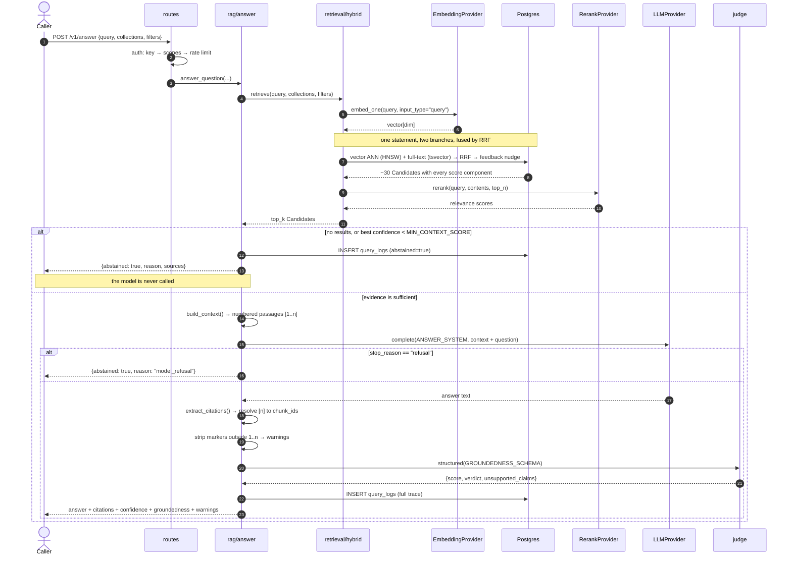
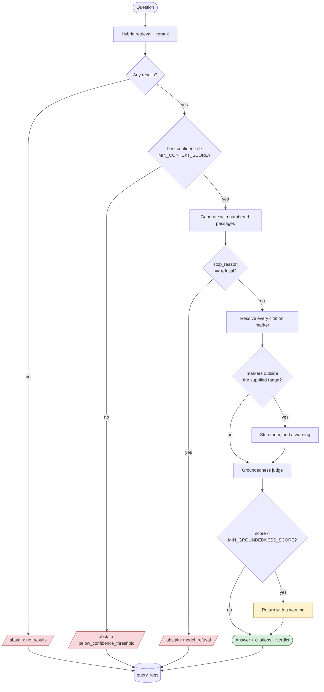
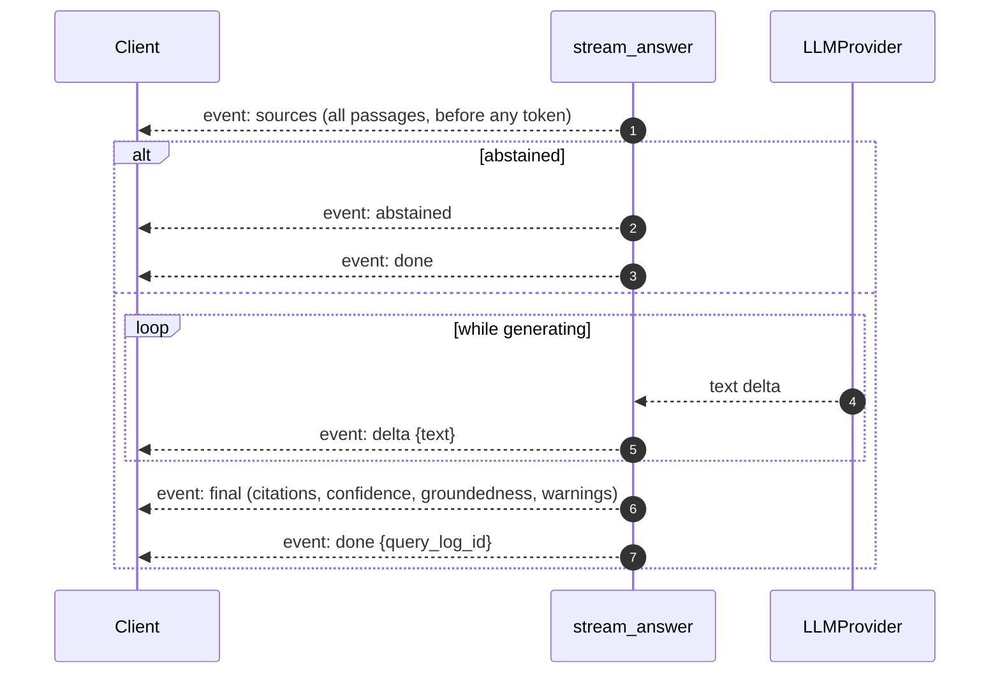

# Flow — asking a question

The path from a question to a verified answer, and every point where the system can decide **not** to answer.

## Full sequence

## The four decision points

**Abstention is cheap and early.** Gates 1 and 2 fire before any generation call, so a question the corpus cannot answer costs one embedding call and one query — not an LLM round trip. This is also the layer that catches most hallucinations, because most hallucinations are simply a model being asked something its context does not cover.

**A low groundedness score warns, it does not suppress.** The caller gets the answer plus the verdict and decides. Silently withholding an answer the model did produce would hide information from an operator mid-incident, which is its own failure mode.

## Streaming variant

`POST /v1/answer/stream` runs the same pipeline and emits Server-Sent Events:

Two properties a client must respect:

1. **Sources arrive before the first token**, so a UI can render citations while the answer streams — and a caller can abort early if the retrieved passages are obviously wrong.
2. **Deltas are unverified by construction.** Citation validation and the judge run on the assembled answer, so `final` is the event to trust. A client that renders deltas and ignores `final` has opted out of the guardrails.

`EventSource` cannot be used: it only issues GET, and this endpoint is a POST. Clients read the body stream and parse frames themselves — see [frontend.md](../frontend.md#consuming-the-sse-stream).

## Async variant

With `callback_url` set, `/v1/answer` returns `202` immediately, the worker runs the same `answer_question()`, and the result is POSTed to the caller. The answer is persisted either way, so a failed delivery is recoverable through `GET /v1/answer/{request_id}` — the callback is an optimization, not the source of truth.

## Where the time goes

| Stage | Typical | Notes |
|---|---|---|
| Query embedding | 50–200 ms | One vendor call; the floor for any search |
| Fusion SQL | 2–10 ms | Measured on the seeded corpus; HNSW keeps this flat as the corpus grows |
| Rerank | 100–400 ms | Skipped when `RERANK_ENABLED=false` |
| Generation | seconds | Dominates; stream it |
| Groundedness judge | 1–3 s | Runs at `JUDGE_EFFORT=low`; disable with `GROUNDEDNESS_CHECK=false` |

The retrieval half is milliseconds. Everything expensive is a vendor round trip, which is why `/search` exists as a separate endpoint: an agent that only needs evidence should not pay for generation.

---

Related: [retrieval.md](../retrieval.md) · [anti-hallucination.md](../anti-hallucination.md)
