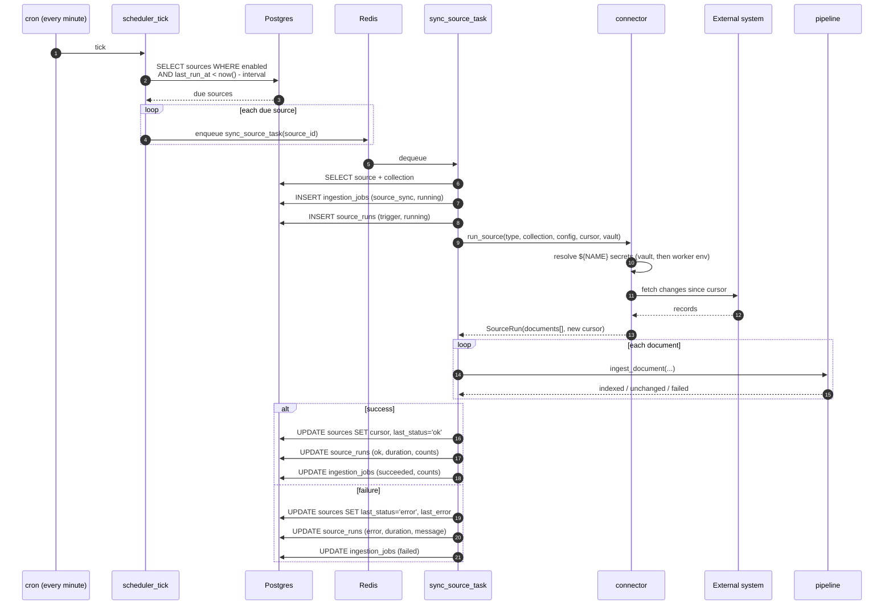
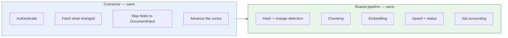

# Flow — polling a source

How the index stays current without anyone pushing to it.

## Scheduler



The schedule lives in `sources.interval_seconds`, not in cron entries. Changing how often a source polls is an API call, not a redeploy — and a source that starts failing is visible in `GET /v1/sources` (`last_status`, `last_error`) without reading logs.

## Why every attempt is recorded

`sources.last_status` is overwritten on every poll, which makes it the wrong thing to trust: a connector failing one poll in ten looks healthy nine times out of ten, and an intermittent failure is invisible five minutes after it happens.

`source_runs` keeps one row per attempt — trigger (`schedule` or `manual`), duration, and the document counts split into indexed / unchanged / failed. `GET /v1/sources/{id}/runs` is what to read when diagnosing; `last_status` is only useful as an at-a-glance badge.

The counts matter as much as the status. A run that is `ok` with `documents=0` is a source whose filter matches nothing — green, and indexing nothing. That is the failure mode `POST /v1/sources/test` exists to catch before it is ever saved.

Rows are pruned on the same schedule as traces (`TRACE_RETENTION_DAYS`); at a 60-second interval a single source produces 1440 rows a day.

The cron tick only *dispatches*. Fetching happens in normal jobs with arq's retries and timeouts, so a hung vendor call cannot block the tick or delay other sources.

## Cursors

Each connector decides what "changed since last time" means for its system. That is the whole reason the interface returns a cursor instead of the framework imposing one.

| Connector | Cursor | Why this and not something else |
|---|---|---|
| `filesystem` | max file mtime | Cheapest available signal on a local tree |
| `git_repo` | commit SHA | A fresh clone rewrites every mtime, so an mtime cursor re-embeds the whole repo on any runner that starts clean |
| `jira` | `updated` watermark in JQL | Server-side filtering; minute granularity means the boundary minute is re-fetched, which content hashing makes free |
| `confluence` | `lastmodified` in CQL | Same shape as Jira |
| `slack` | newest thread ts, rewound 24h | Threads get late replies; a strict watermark would freeze a conversation the moment it went quiet |
| `aws_logs` | window end timestamp | Logs are a time series, not a mutable collection |
| `http_json` | configurable param | Whatever the upstream API supports |

## Deletions

Only `git_repo` detects deletions, via `git diff --name-status`: a removed file calls `delete_document()`, which soft-deletes the row and hard-deletes its chunks so the index reclaims the space.

The others do not, and that is a deliberate gap rather than an oversight — detecting deletion in a watermark-based feed requires a full enumeration every poll, which defeats incrementality. Deleting a Jira ticket does not remove it from the index; use `DELETE /v1/documents/{collection}/{external_id}` or drop the collection and re-sync.

## What a connector must not do



A connector that chunks or embeds is a connector that will drift from the others. Keeping that boundary is what makes adding a vendor one file.

## Secrets

Any config value written `${NAME}` is resolved at poll time from two places, in order:

1. the **encrypted vault** — AES-256-GCM rows in Postgres, decrypted once per poll under `SECRETS_KEY`;
2. the **worker's environment**, the original mechanism, unchanged.

Vault-first is what makes a token pasted in the UI override a stale one baked into `.env`. The alternative would be a form that appears to save and silently changes nothing. Nothing readable is stored in Postgres and nothing comes back out of `GET /v1/sources`. See [setup.md](../setup.md#secrets).

Only the names actually read during a poll are marked used, so a credential nobody references is visibly stale in the UI — which is the signal for deleting it.

A missing name raises `MissingSecret` and fails the run with an explicit message, recorded in `sources.last_error`:

```
source config references ${JIRA_API_TOKEN}, which is neither stored in the
secret vault nor set in the worker environment
```

Failing loudly is the point. A connector that polls with an empty token produces a 401 deep inside a vendor client, several layers away from the actual mistake.

A single undecryptable row does not fail the whole load — the source that references it fails on its own, which keeps one bad row from stopping every other source.

## Adding a connector

```python
# app/ingestion/sources/pagerduty.py
from app.ingestion.sources import SourceRun, register

@register("pagerduty")
async def run_pagerduty_source(collection: str, config: dict, cursor: dict) -> SourceRun:
    ...
    return SourceRun(documents=docs, cursor={"since": watermark})
```

Import it in `app/ingestion/sources/__init__.py` and it is done: `SOURCE_TYPES` is derived from the registry, and `SourceIn` validates against that, so the API accepts the new type with no schema change and rejects unknown types with the available list.

---

Config for every connector: [sources.md](../sources.md)
