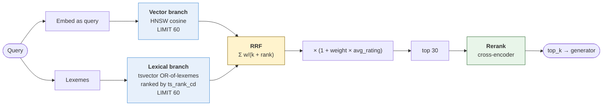

# Retrieval

How a question becomes a ranked list of passages. Implementation: `app/retrieval/hybrid.py`.

## The problem hybrid search solves

Incident questions mix two kinds of language in one sentence:

> "checkout is timing out since the deploy, seeing `ERR_UPSTREAM_TIMEOUT` on `payments-api`"

The first half is fuzzy and semantic. The second half is exact tokens — an error code and a service name that must match *literally*. Dense vectors handle the first and are unreliable on the second: embeddings normalize away exactly the character-level precision that makes `ERR_UPSTREAM_TIMEOUT` useful. Lexical search is the reverse.

Running only one branch means being systematically wrong on half of every real question.

## Pipeline



Both branches run inside **one SQL statement** — two CTEs joined `FULL OUTER ... USING (chunk_id)`. One round trip, and Postgres plans it as a whole.

## Reciprocal Rank Fusion

```
score(d) = Σ  weight_branch / (k + rank_branch(d))
```

with `k = RRF_K` (default 60) and per-branch weights.

RRF reads **ranks, not scores**. That is the entire point: the vector branch returns cosine similarity in `[-1, 1]` and the lexical branch returns `ts_rank_cd`, which is unbounded and corpus-dependent. Normalizing two such scales into a comparable range requires calibration that drifts as the corpus changes. Ranks need no calibration.

`k` damps the head of the distribution: with `k = 60`, ranks 1 and 2 differ by ~1.6%, so a document must win on *both* branches to clearly beat one that wins on either. Lowering `k` makes the top rank dominate; raising it flattens the fusion.

## The lexical branch ORs its terms

```sql
SELECT string_agg(quote_literal(lexeme), ' | ')
FROM unnest(tsvector_to_array(to_tsvector($config, $query))) AS lexeme
```

`websearch_to_tsquery` and `plainto_tsquery` **AND** every term. On the query above, that requires one chunk to contain *checkout* and *timing* and *out* and *ERR_UPSTREAM_TIMEOUT* and *pgbouncer* — which nothing does, so the lexical branch returns zero rows and hybrid search silently degrades to vector-only.

This was a real bug here. It produces no error and no warning: search still works, results are still plausible, and the exact-token half of every query is quietly gone. The `retrieval_mode` badge in the UI exists precisely so this is visible — if everything says `vector`, the lexical branch has stopped contributing.

OR-ing keeps recall and lets `ts_rank_cd` discriminate: it already rewards matching more query terms, closer together, and that ranking is exactly the signal RRF wants from this branch.

Each lexeme is `quote_literal`-wrapped so tokens containing punctuation cannot break the tsquery parser.

## Reranking

Fusion is cheap and approximate: it gets the right chunk into the top 30. A cross-encoder reads the query and passage *together* and gets it into the top 3 — which matters because only the top `RETRIEVAL_TOP_K` reach the generator.

A reranker outage degrades ranking quality but must not take retrieval down, so the failure path logs and falls back to fusion order.

## Tuning

| Setting | Default | Raise it when | Lower it when |
|---|---|---|---|
| `RETRIEVAL_CANDIDATES` | 60 | The right passage is missed entirely (recall problem) | Latency matters more than tail recall |
| `RERANK_CANDIDATES` | 30 | The reranker should see more of the fusion tail | Rerank cost is significant |
| `RETRIEVAL_TOP_K` | 8 | Answers miss context that was retrieved | Answers drift or cite marginal passages |
| `RRF_K` | 60 | You want the two branches balanced more evenly | You want rank-1 hits to dominate |
| `VECTOR_WEIGHT` | 1.0 | The corpus is prose and questions are conceptual | — |
| `LEXICAL_WEIGHT` | 1.0 | Queries are full of identifiers, error codes, SQL | — |
| `FEEDBACK_WEIGHT` | 0.15 | Ratings are plentiful and trustworthy | Feedback is sparse or adversarial |
| `MIN_CONTEXT_SCORE` | 0.48 | Too many weakly-supported answers | The system abstains on answerable questions |

Change one at a time and measure with `make eval` — it scores recall@k, MRR, abstention correctness and groundedness against a golden set, and fails on a regression. Without it these are all vibes, and a change that reads like an improvement can quietly cost recall. See [evaluation.md](evaluation.md).

`MIN_CONTEXT_SCORE` is the one knob that should never be set by feel: the harness reports where answerable and unanswerable questions separate, and the threshold belongs in that gap.

## Filtering

`filters` is a JSONB containment match against `chunks.metadata`, backed by a GIN index:

```json
{"service": "payments-api", "severity": "P1"}
```

Because document metadata is merged into chunk metadata at ingest, one filter covers both levels. Filtering happens **inside both branches** — before fusion — so a filter narrows what each branch retrieves rather than discarding results after the fact. An empty filter (`{}`) matches everything.

## Reading the scores

```json
"scores": {"vector": 0.38, "lexical": 0.40, "rrf": 0.0328, "rerank": null, "feedback": 0.0},
"retrieval_mode": "hybrid"
```

- `vector` — cosine similarity, `[0, 1]`, absolute and comparable across queries.
- `lexical` — `ts_rank_cd`, relative *within* one query only.
- `rrf` — fused, bounded by `(vector_weight + lexical_weight) / (k + 1)`.
- `rerank` — cross-encoder relevance, `[0, 1]`, absolute.
- `retrieval_mode` — `hybrid` (both branches), `vector`, or `lexical`.

**Ranking uses `rerank ?? rrf`. The abstention gate uses `rerank ?? vector ?? lexical` — never `rrf`.** The two are different questions: "which of these is best" and "is the best one good enough". RRF answers the first and cannot answer the second, because a rank-based score always puts *something* near the top. See [decisions.md](decisions.md#confidence-is-not-the-rrf-score).
